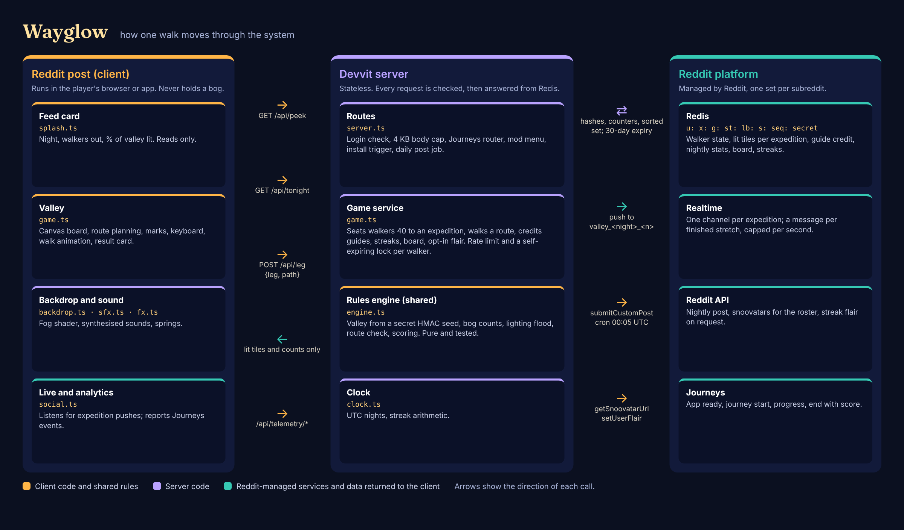

# Wayglow

   

**One dark valley. Three lanterns. Every step you take stays lit for the walkers after you.**

Wayglow is a daily game for Reddit, built on Devvit Web as an interactive post. Each night the community gets a valley hidden in darkness. Nobody can see all of it. Every walker lights the tiles they cross, for everyone, so the subreddit finds the way across together.

## How to play

1. **Open tonight's post.** You start at the camp at the bottom. The beacon burns at the top.
2. **Read the numbers.** A lit tile shows how many bogs touch it, counting diagonals. A lit tile with no number touches none.
3. **Plan a stretch.** Drag from your lantern through any tiles, lit or dark, then press **Walk**. You can walk in as many stretches as you like.
4. **Mind the dark.** Stepping into a bog costs one of your three lanterns. The sunk lantern marks that bog for every walker after you.
5. **Reach the beacon.** Your walk ends at the beacon, or when the third lantern sinks. Either way, everything you lit stays lit.

One ranked walk per night. A new valley opens at 00:00 UTC.

- **Lantern sense.** When you plan a step into the dark, the game tells you what the visible numbers already prove: a tick means the step is certainly dry, a question mark means it is a gamble, and it will not let you step onto a tile the numbers prove is a bog. It uses only the simplest rule, so deeper deductions are still yours to find.
- **Walking on.** If all your lanterns sink, your score for the night is fixed, but you can relight a lantern up to three times and keep going. What you light and mark still helps your expedition, and you can still reach the flame.

Other controls:

- **Mark a bog you suspect.** Press and hold a dark tile, or right-click it. Routes will not cross a mark. Marks are private.
- **Keyboard.** Arrow keys plan, Shift with an arrow marks, Enter walks, Escape clears.
- **Sound.** Synthesised in the browser; the button in the header turns it off.

### The Deep

When your nightly walk is over, **Go deeper** opens an endless descent. Each valley you cross drops you into the next, with more bogs every time. Your lanterns carry over, and every third valley crossed earns a spare. The run ends when the last lantern sinks, and you can go again as often as you like; only your deepest run of the night counts on the Deep board.

Every walker gets the same valleys at each depth, so runs can be compared, but in The Deep nobody lights the way for you.

### Seven kinds of night

| Night (UTC) | Name          | What changes                                  |
| ----------- | ------------- | --------------------------------------------- |
| Sunday      | Long dark     | A plain night: three lanterns, three sparks   |
| Monday      | Gentle night  | Fewer bogs, four sparks                       |
| Tuesday     | Firefly night | Six sparks for every walker                   |
| Wednesday   | Still night   | A plain night                                 |
| Thursday    | Thick fog     | One spark each, so walkers lean on each other |
| Friday      | Marsh night   | More bogs                                     |
| Saturday    | Deep marsh    | The most bogs, and a fourth lantern           |

### Scoring

| Part                     | Points                                                  |
| ------------------------ | ------------------------------------------------------- |
| Lanterns kept on arrival | 100 each                                                |
| Route                    | 100, minus 4 for every step over the shortest dry route |
| First light              | 2 for every tile you were first to light                |

## What makes it a community game

- **Expeditions.** Walkers are grouped 40 to a valley, in order of arrival. What one walker lights, the other 39 can use.
- **Sparks.** Each walker arrives with three sparks that light dry tiles somewhere up the valley, so every arrival adds something even before the first step.
- **Useful failure.** A lost lantern is a warning sign for everyone else.
- **Guides.** When another walker steps on a tile you lit first, you are credited once for that walker. The result card and the next night's welcome show how many walkers your light guided.
- **Live.** A walker's new lights and sunk lanterns reach the rest of the expedition as they happen, with a short note saying who did it.
- **The roster.** The header shows the snoovatars of the walkers most recently out in your expedition, and a sunk lantern remembers whose it was.
- **A shared goal.** The header shows how much of your expedition's valley is lit.
- **Ranks.** Tiles you light first add up across nights: Spark, Candle, Lantern, Beacon, Lighthouse.
- **Copy my crossing.** The result card copies a short, spoiler-safe summary with an emoji map of your valley, ready to paste in the comments.
- **How the night went.** The result card shows how many of tonight's walkers kept three, two, one or no lanterns.
- **Streaks.** Walk on consecutive nights to build one. A streak of three or more survives one missed night, once a week. From two nights on you can choose to wear it as subreddit flair; nothing is set without your tap.

## How it is built



```
src/shared/engine.ts   Rules: seeded valley generator, bog counts, lighting, route checks, scoring
src/shared/api.ts      Request and response types shared by client and server
src/server/game.ts     Seating, walking, streaks and the board, on Devvit Redis
src/server/deep.ts     The Deep: private chained valleys and their board
src/server/server.ts   HTTP routes, menu action, install trigger, daily post job
src/client/splash.ts   Feed card
src/client/backdrop.ts Fog and lantern-heat shader
src/client/fx.ts       Springs, count-up and easing helpers
src/client/sfx.ts      Synthesised sounds
src/client/social.ts   Live updates, roster faces, Journeys events
src/client/game.ts     Canvas valley, route planning, walk animation, result card
src/test/              In-memory Redis and a local preview server
```

- **The server holds the valley.** Bog positions never leave it. The client receives lit tiles and their counts and nothing else, and every route is checked and walked on the server.
- **Valleys come from a secret seed.** Each install creates a random secret, and each valley is generated from an HMAC of that secret, the date and the expedition. Reading this repository does not reveal tomorrow's valley.
- **No locks on shared state.** Lit tiles are only ever added, so walkers in the same expedition cannot conflict. A short per-walker lock, which expires on its own, stops double submits.
- **Bounded keys.** Expeditions have a fixed size, so no Redis key grows with the size of the crowd.
- **Retention.** Every key that names a walker expires within 30 days.
- **Live updates are a bonus, not a dependency.** One realtime message per finished stretch, capped per second on the server; the client still polls.
- **Devvit Journeys.** App ready, journey start on the first committed stretch, progress by distance up the valley, and an end event with the score. Reddit only records these once the app is published and approved.
- **Reddit-side extras cannot break a walk.** Snoovatar lookups and live pushes are wrapped so a failure is logged and skipped.
- **No external requests and no free-text input.**

### Look and motion

- **Backdrop:** one hand-written WebGL fragment shader draws drifting fog and the heat of the lantern and the flame. No 3D library is loaded. Without WebGL a CSS gradient shows instead.
- **Board:** Canvas 2D with pre-rendered tile sprites, so every frame is a few dozen image draws. Tiles rise in a wave, turn over when lit, and dim with distance from the lantern.
- **Interface:** [Motion](https://motion.dev) drives the springs and staggered entrances.
- **Type:** Fraunces, self-hosted from `public/fonts` under the SIL Open Font License.
- **Reduced motion:** every animation is skipped or shortened when the device asks for it.

Difficulty is tuned by a test that sends a careful, logic-first walker alone into hundreds of dark valleys for each weekday and checks how often it crosses.

## Development

Requires Node 22.6 or newer (24 recommended).

```sh
npm install
npm run preview     # play locally at http://localhost:5173/game.html, no Reddit needed
npm test            # types, lint, unit tests, build
npm run playtest    # run on your test subreddit through Devvit
npm run upload      # build and upload a new version
```

The local preview runs the real server code against an in-memory Redis. Add `?as=name` to an API call, or send an `x-user` header, to act as another walker.

## License

BSD-3-Clause. Scaffolded from Reddit's Devvit Web hello-world template; see `LICENSE`.
